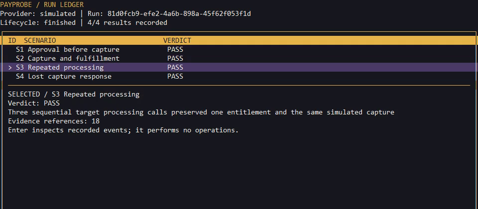
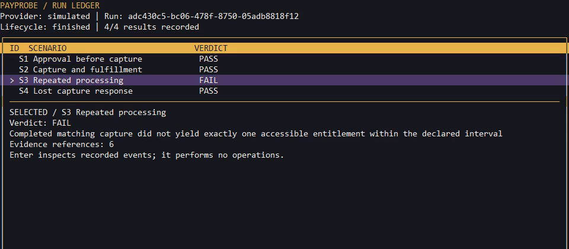
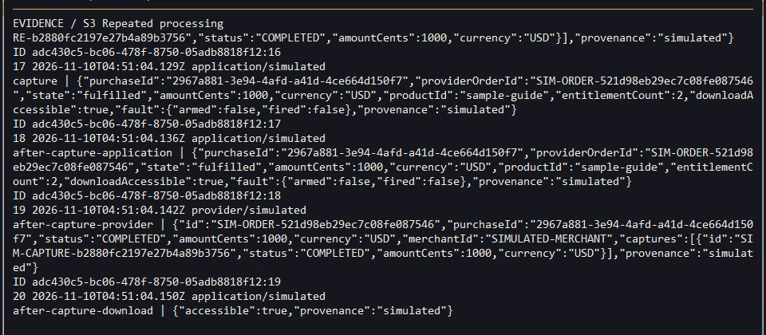
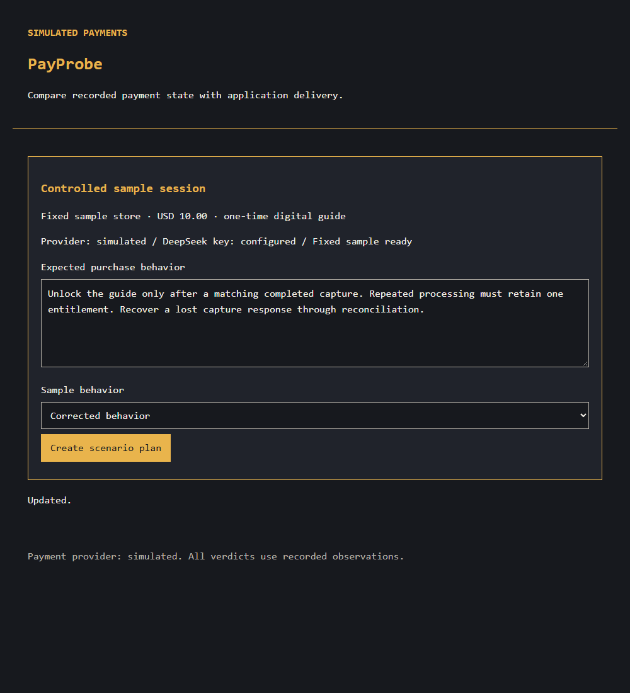
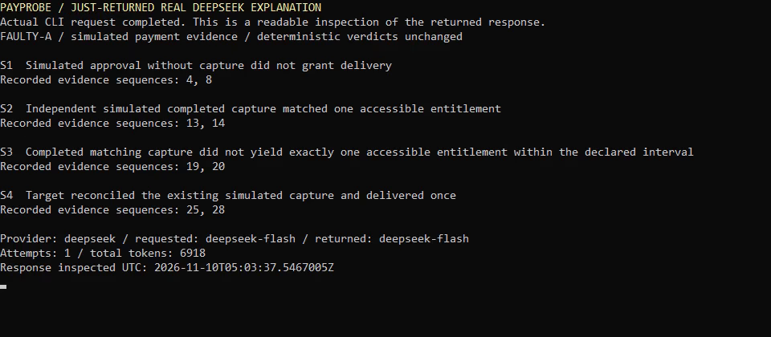

<h1 align="center">PayProbe</h1>

  <strong>Approval is not payment. Delivery needs evidence.</strong> 
  Reviewed test plans, payment-lifecycle fault scenarios and inspectable results in one developer tool.

  Built for the <a href="https://paypalaihackathon.devpost.com/">PayPal AI Hackathon 2026</a> 
  Payment lifecycle diagnostics · By Desan Vasu

  
  
  
  
  

  <a href="#features">Features</a> ·
  <a href="#demo">Demo</a> ·
  <a href="https://youtu.be/N5HF1Um5x_U">Watch video</a> ·
  <a href="#get-started">Get started</a> ·
  <a href="#deepseek--reviewed-execution">DeepSeek &amp; execution</a> ·
  <a href="#documentation">Documentation</a>

  
   Actual terminal capture · corrected recorded run · simulated payment provider.

## Why PayProbe

A checkout can look successful while delivery is wrong. Approval might unlock a download before capture, repeated processing might grant access twice, or a successful capture with a lost response might leave the application uncertain.

PayProbe turns a digital-purchase requirement into a reviewed scenario plan. A deterministic runner compares application delivery with a separately recorded simulated payment ledger, retains observations and makes each finding inspectable. DeepSeek helps plan and explain; evidence and deterministic checks determine the verdicts.

**Current scope:** a working local CLI and browser prototype with **simulated payments and real DeepSeek API use**. Actual PayPal API integration and sandbox verification remain deferred. The [submitted PayPal AI Hackathon 2026 entry](https://devpost.com/software/payprobe-wng98r) discloses that boundary.

## Features

<table>
<tr>
<td width="50%" valign="top">

### Review before execution

Generate a bounded scenario plan, inspect the saved draft and explicitly accept it. Execution is bound to that reviewed source.

</td>
<td width="50%" valign="top">

### Exercise four payment boundaries

Check approval without capture, matching capture and delivery, sequential repeat processing, and reconciliation after a suppressed capture response.

</td>
</tr>
<tr>
<td width="50%" valign="top">

### Preserve uncertainty

Keep PASS, FAIL, INCONCLUSIVE, UNSUPPORTED and ERROR distinct. Missing evidence and an explanation failure cannot manufacture a successful payment check.

</td>
<td width="50%" valign="top">

### Resume an interrupted run

SQLite retains reviewed plans, operations, observations and run state. Resume the existing case instead of silently replanning or starting a replacement run.

</td>
</tr>
<tr>
<td width="50%" valign="top">

### Inspect the terminal ledger

Select a scenario, filter results and open the recorded evidence in the graphite/amber/ivory/plum terminal interface. Inspection performs no payment operations.

</td>
<td width="50%" valign="top">

### Use the browser or export reports

Follow the plan, review, simulated approval and result workflow in a local browser. Export text/JSON and request an optional evidence-referenced explanation.

</td>
</tr>
</table>

## Demo

**[Watch the narrated 2:50 walkthrough on YouTube →](https://youtu.be/N5HF1Um5x_U)** · [Submitted project](https://devpost.com/software/payprobe-wng98r) · [Download the source release](https://github.com/desanv01/PayProbe/releases/tag/v0.1.0-simulated)

1. Inspect a real DeepSeek-generated plan and explicitly review it.
2. Run the controlled sample workflow, pause for simulated approval and resume the same case.
3. Inspect a seeded duplicate-delivery failure: one capture, two entitlements.
4. Compare a separate corrected run and inspect lost-response reconciliation evidence.
5. Watch an actual DeepSeek request, its complete wait and returned explanation, then export the recorded report.

<table>
<tr>
<td width="50%" valign="top">
  
  
<strong>A visible failure.</strong> An intentionally faulty sample store grants two entitlements after one capture.

</td>
<td width="50%" valign="top">
  
  
<strong>The evidence behind the result.</strong> Compare simulated provider capture with application delivery observations.

</td>
</tr>
<tr>
<td width="50%" valign="top">
  
  
<strong>A browser workflow too.</strong> Local planning, review, approval and reports. <a href="docs/assets/demo/browser.png">Inspect the recorded fixture results →</a>

</td>
<td width="50%" valign="top">
  
  
<strong>Real AI, referenced evidence.</strong> Readable inspection of the just-returned response; deterministic verdicts remain unchanged.

</td>
</tr>
</table>

[Capture provenance and attribution →](docs/assets/demo/README.md)

## Get started

### Install and start locally

You need **Node.js 24.14+ within the 24.x line**, npm and a terminal. A private **DeepSeek API key** with available credit is needed for fresh planning and explanations. Payments are simulated; no PayPal account or credentials are required for this release.

Clone the repository or extract the [packaged source](https://github.com/desanv01/PayProbe/releases/tag/v0.1.0-simulated), then run:

~~~powershell
git clone https://github.com/desanv01/PayProbe.git
cd PayProbe
npm ci
npm run build
npm start -- doctor
~~~

<code>doctor</code> creates <code>.env.local</code> from the blank template only if absent. Set <code>DEEPSEEK_API_KEY</code> there; preserve an existing configuration. Leave PayPal fields blank. Defaults are <code>deepseek-flash</code> and the <code>simulated</code> provider. Credentials stay local and ignored by Git.

~~~powershell
npm start -- serve
~~~

Keep the server running and open **[http://127.0.0.1:4310/demo](http://127.0.0.1:4310/demo)** on the same computer. This is a local application; no public live-demo service or judge key is supplied.

### Plan, review and run from the CLI

In a second terminal at the same project root, with the same configuration:

~~~powershell
New-Item -ItemType Directory -Force .private/demo | Out-Null
npm start -- plan examples/download-contract.json --out .private/demo/draft-plan.json
Get-Content .private/demo/draft-plan.json
# Accept only after inspecting the exact saved draft:
npm start -- plan --review .private/demo/draft-plan.json --out .private/demo/reviewed-plan.json
npm start -- run .private/demo/reviewed-plan.json --auto-approve-simulated
~~~

The first plan command calls DeepSeek. Review and execution make no new AI request. The approval flag authorizes **simulated orders only**; omit it to pause for approval. Use fresh output filenames for another attempt—existing plan/explanation files are never overwritten.

### Inspect, explain or resume

Use the actual run ID returned by execution:

~~~powershell
$runId = 'PASTE_ACTUAL_RUN_ID'
npm start -- ledger $runId
npm start -- report $runId --format text
npm start -- report $runId --format json
# Optional fresh DeepSeek request:
npm start -- explain $runId --out .private/demo/explanation.json
# Continue an existing paused or interrupted run:
npm start -- resume $runId --auto-approve-simulated
~~~

Use arrows or <code>j/k</code> to select, <code>Enter</code> for evidence, <code>/</code> to filter and <code>q</code> to leave the ledger. Non-interactive terminals receive plain text. Keep the SQLite directory for recovery; browser sessions expire after a server restart while recorded runs persist. Node's experimental SQLite warning is expected.

[Complete setup and configuration →](docs/release/SETUP.md) · [Judge walkthrough →](docs/release/JUDGE-GUIDE.md)

## DeepSeek & reviewed execution

DeepSeek maps a requirement onto supported scenarios through a bounded, schema-validated JSON interface. The saved plan requires explicit review; an unreviewed or modified plan cannot run. The explainer receives recorded evidence and must cite valid references. It does not decide or change deterministic verdicts.

The <code>openai</code> npm package is compatible transport with an explicit **DeepSeek** endpoint and key. No OpenAI runtime account or key is needed. **<code>deepseek-flash</code> is a rolling alias** for the requested V4.1-Flash-1017 model; an immutable provider snapshot is not claimed.

Review, run, resume, ledger and report commands require no fresh model call. Planning and explanation can consume API credit. The repository ships no private key, database or accepted private run. [AI workflow implementation →](src/ai)

## Recorded results

| Check | Boundary | Observed demonstration |
|---|---|---|
| S1 | Approval before capture | Simulated approval does not grant delivery |
| S2 | Capture and fulfillment | Matching completed capture yields one accessible entitlement |
| S3 | Repeated processing | Corrected run preserves one entitlement across three sequential calls; faulty sample shows two and FAIL |
| S4 | Lost capture response | Existing simulated capture is reconciled and delivery occurs once |

A reviewed real-DeepSeek/simulator journey completed all four checks with **42 evidence events**. The film's faulty, corrected and pause/resume takes are separate runs; their identifiers and counts must not be combined. These are observations of our controlled sample, not third-party vulnerability findings or a production qualification.

Focused checks covered process restart, reviewed-plan persistence, duplicate delivery, wrong amount/currency, missing evidence, redaction, terminal/browser interaction and clean setup. Source CI runs the foundation, runner, AI workflow, stabilization and UI checks. [Acceptance matrix →](docs/stabilization/ACCEPTANCE-MATRIX.md)

## Built with

| Interfaces | Application & validation | Persistence & recovery | Model access |
|---|---|---|---|
| Commander CLI · terminal ledger · local browser | Node.js 24 · TypeScript · Fastify · Zod | SQLite · persisted runs, reviewed plans and evidence | Official DeepSeek API · compatible SDK transport |

The [simulated prerelease](https://github.com/desanv01/PayProbe/releases/tag/v0.1.0-simulated) packages verified runtime source; newer repository commits add the video and presentation documentation. [Source archive verification →](docs/stabilization/ARTIFACT-ACCEPTANCE.md)

## Architecture

~~~mermaid
flowchart LR
    A[Purchase requirement] --> B[DeepSeek draft plan]
    B --> C[Explicit human review]
    C --> D[Deterministic scenario runner]
    D --> E[Sample application and delivery]
    D --> F[Separate simulated payment ledger]
    E --> G[Persisted observations and evidence]
    F --> G
    G --> H[Deterministic verdicts]
    H --> I[CLI ledger and browser reports]
    G --> J[DeepSeek explanation with references]
    J --> I
~~~

The application and payment observations use separate paths inside one backend. This is a testable simulation boundary, not independent third-party payment verification. [Runner](src/runner) · [HTTP adapter](src/adapters) · [Sample store](src/sample-store) · [Storage](src/storage)

## Scope and contributions

Built solo by **Desan Vasu** for **PayPal AI Hackathon 2026** and [submitted on Devpost](https://devpost.com/software/payprobe-wng98r). The contribution is the reviewed planning/execution workflow, controlled payment-fault sample, persisted evidence/recovery and inspectable terminal/browser reports. Codex assisted implementation and debugging. [Contribution and attribution record →](docs/release/CONTRIBUTIONS.md)

Current scope is a controlled digital-download target, USD integer cents, one full capture and sequential repeat checks. Actual PayPal integration, refunds, subscriptions, webhooks, concurrent-race coverage, arbitrary merchants and production/security certification remain outside this release. The receipt confirms submission, not organizer eligibility or an award. [Submission receipt →](SUBMISSION-RECEIPT.md)

Repository presentation and terminal direction draw inspiration from [FollowThrough](https://github.com/desanv01/FollowThrough); the HyperFrames film follows the owner's MajuPilot editorial direction. Actual PayProbe screenshots retain their approved palette. [Media credits →](video-production/payprobe-demo/assets/MEDIA-CREDITS.md)

## Documentation

- [Setup and configuration](docs/release/SETUP.md)
- [Judge walkthrough and no-key inspection](docs/release/JUDGE-GUIDE.md)
- [Acceptance matrix](docs/stabilization/ACCEPTANCE-MATRIX.md) and [package verification](docs/stabilization/ARTIFACT-ACCEPTANCE.md)
- [Actual UI captures](docs/assets/demo/README.md) and [connected browser checks](docs/design/runtime-check/README.md)
- [Delivery checklist](docs/release/CHECKLIST.md) and [video delivery](VIDEO-DELIVERY.md)
- [Contributions and prior-work attribution](docs/release/CONTRIBUTIONS.md)
- [Contribution guidelines and scope](docs/release/CONTRIBUTING-LIMITATIONS.md)

## Feedback

[Open an issue](https://github.com/desanv01/PayProbe/issues) with reproducible steps, expected behavior and sanitized output. Keep keys, payment data and private documents out of public reports.

## License

Original PayProbe code and documentation are [MIT licensed](LICENSE). Dependencies, fonts, music and other third-party material retain their own rights and terms; see the [contribution record](docs/release/CONTRIBUTIONS.md) and [media credits](video-production/payprobe-demo/assets/MEDIA-CREDITS.md).
